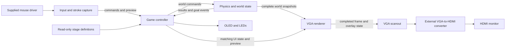
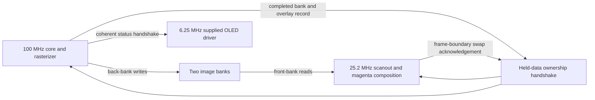

# Architecture Spine — Q Remastered on FPGA

## Design Paradigm

Synchronous dataflow with single-owner state. Input produces commands; physics owns the mutable world; the controller owns game state; presentation consumes immutable snapshots. This is the shared feature-level contract. Prototype-dependent choices below are implementation seeds, not measured fit guarantees.

## Invariants & Rules

### AD-1 — State ownership [ADOPTED]

- **Binds:** All modules.
- **Prevents:** Multiple modules changing the same state or graphics becoming a second physics engine.
- **Rule:** Physics alone mutates accepted body poses, velocities and geometry. The controller alone changes stage, game mode and remaining allowance. Input alone captures the provisional stroke. Level definitions are immutable. Displays read presentation data and never mutate gameplay. Dependencies and message directions follow the diagram; modules do not write another owner's registers.

### AD-2 — World limits and stage data [ADOPTED]

- **Binds:** Levels, input, physics and graphics.
- **Prevents:** Different object counts, obstacle primitives or goal definitions.
- **Rule:** Provide three built-in selectable stages. Each attempt has one ball, five accepted strokes maximum and up to eight fixed obstacles. Each stroke has at most eight vertices and seven equal-radius capsule segments forming one rigid body. Each fixed platform or sloped ramp is one static capsule. Four container walls are separate from the obstacle cap. The full left boundary is the common goal; there is no separate target body. Bodies remain until reset or leaving the attempt. The eight-point profile remains subject to integrated resource validation.

### AD-3 — Shared coordinates and stored geometry [ADOPTED]

- **Binds:** Input conversion, level data, physics and presentation geometry.
- **Prevents:** Coordinate, scale, sign or boundary mismatches.
- **Rule:** Use a 640×480 playfield with upper-left origin, x right and y down. Mouse coordinates are clamped to x=0..639, y=0..479. World/local positions, radii, bounded per-segment lengths and linear velocities use signed 18-bit two's-complement storage with six fractional bits: value=integer/64. Accumulated polyline length and mass moments require wider storage; a long seven-segment path can exceed the single-field positive limit of 2047.984375 pixels. Linear velocity units are pixels per 1/60-second outer update. Widen before arithmetic; general coordinate differences require 19 bits, products of these differences 38 bits and two-product sums 39 bits. Wider comparisons retain their required precision. Trigonometric coefficients, normals, mass properties, impulses and accumulators require separate documented scales; they must not inherit the geometry binary point by default.

### AD-4 — Stroke preview and admission transaction [ADOPTED]

- **Binds:** Input, controller, physics and graphics.
- **Prevents:** Hidden geometry changes on release, duplicate bodies or charging rejected strokes.
- **Rule:** Simplify continuously while dragging, retaining the starting point, current endpoint and significant bends within eight vertices. Render the actual simplified capsule shape proposed for admission. On release, hold an immutable request until received; permit only one outstanding create request. Physics validates the final samples against the authoritative current ball, accepted strokes and fixed obstacles, then atomically inserts one rigid body or rejects the entire stroke. Positive penetration rejects; tangency is allowed. Do not test capsules within the same rigid body against each other. Charge one stroke exactly once on accepted acknowledgement. Rejection inserts nothing, applies no impulse and preserves allowance. At zero allowance suppress new creation and show “No strokes left”; overlap rejection clears preview and shows “Stroke overlaps an object.” Admission, collision and preview use the same radius and sample geometry. Fewer than two distinct vertices or zero total length cannot form the adopted wire body and must be rejected without charge.

### AD-5 — Controller transitions and attempt identity [ADOPTED]

- **Binds:** Input, controller, physics and presentation.
- **Prevents:** Stale results affecting a new attempt, extra simulation after pause or divergent menu behavior.
- **Rule:** Startup enters Lobby. Clicking a stage loads and starts it without a second Start action. Active, Paused and Victory are distinct controller modes. Pause is disabled while the left mouse button is held: ignore requests during a draw and do not queue them. Drawing release only submits the stroke, even over the pause icon, and never automatically pauses. A fresh pause-icon click after release requests pause and is consumed as UI input. A UI click begins over the control and activates on its release; a draw gesture cannot become a pause click. Freeze at the next safe atomic physics boundary; if admission is already in flight, finish that atomic transaction then freeze before further world advancement. Outside pause-menu items, clicks do nothing. Resume preserves the attempt. Reset restores initial bodies, clears strokes and restores five allowance; Back to Lobby discards the attempt. Reset/load advances an attempt generation and invalidates older work, while outstanding transport handshakes are drained safely. A latched current-attempt goal stops further world advancement and takes precedence over a pending valid pause or uncommitted stroke. Victory holds the completed scene: stages 1/2 offer Next Stage and Back to Lobby; stage 3 offers Back to Lobby. No automatic advancement.

### AD-6 — Goal event and containment [ADOPTED]

- **Binds:** Physics, controller, levels and graphics.
- **Prevents:** Tangency being missed, strokes winning or decorative pixels changing the objective.
- **Rule:** Ball contact with the left boundary wins at any height, including tangency. Test widened signed x_ball−r_ball<=0 during relevant movement/boundary processing, before containment correction can erase contact. Latch the goal until the controller acknowledges it; keep it separate from droppable visual snapshots. Stop the winning world and retain its complete snapshot. All other walls are solid/non-goal; the left wall contains strokes. The magenta goal marking and its non-colour cue do not move the physics boundary. VGA blanking coordinates never participate in this test.

### AD-7 — One rigid-body model and transform authority [ADOPTED]

- **Binds:** Admission, physics and graphics.
- **Prevents:** Collisions, mass centers, rotation and displayed geometry disagreeing.
- **Rule:** Treat a stroke as a uniform-density wire following the admitted sampled polyline: mass is proportional to total segment length, center of mass is length weighted and rotational inertia is derived about that center. Sum segment contributions as a deliberate wire approximation, not an exact capsule-union area calculation. Compute/cache mass properties once during admission, and express body-local points relative to the adopted mass center. Static bodies have zero inverse mass/inertia. Physics obtains sine/cosine from a lookup table and refreshes transformed points after any pose change, including corrections. Collision detection and render snapshots consume these same points. Use a bounded sequential impulse solver with deterministic contact order and linear/angular response, accumulated nonnegative normal impulses and Coulomb-bounded accumulated friction impulses. Use low bounce, moderate friction and a low-speed bounce threshold. The circle ball needs angular state if frictional rolling is modeled; visible ball orientation is not required. Do not claim that Box2D software is an FPGA dependency.

### AD-8 — Fixed simulation time and bounded work [ADOPTED]

- **Binds:** Physics, controller, arithmetic scheduling and integration.
- **Prevents:** Simulation speed following input/display traffic or unbounded solver work.
- **Rule:** Schedule fixed 60 Hz outer physics updates in the 100 MHz core with a clock enable, independent of the 40 Hz mouse reports. Use a rational divider or equivalent bounded schedule; 100 MHz is not divisible by 60. Adopt capped linear/angular speeds and small fixed internal substeps; the current seed is two substeps, so integration and force terms must account for half of the outer timestep without changing shared velocity units. Limits account for rotational point motion and collision-induced changes. Refresh geometry, boundaries and goal detection at the required substep operations. Share bounded multicycle arithmetic rather than instantiate one full datapath per primitive pair. Contact and solver limits must be explicit. Do not call repeated contact-solver sweeps repeated geometry scans. If work is still busy, never start an overlapping world update or increase the physical timestep to catch up; expose a deadline diagnostic and hold the last complete world. A design that misses the sustained worst-case deadline is not accepted as meeting 60 Hz. Substeps/caps reduce tunneling but do not prove all grazing contacts; intended stage interactions must be validated.

### AD-9 — Complete presentation and buffer ownership [ADOPTED; BUFFER STRATEGY ASSUMED]

- **Binds:** Controller, physics, renderer, VGA scanout and OLED.
- **Prevents:** Mixed attempts, half-written images, mismatched overlays or lost gameplay events.
- **Rule:** Presentation consumes complete snapshots, never live mutable world registers. Capture one world snapshot and matching UI/preview data for a draw; tag them with attempt generation and frame identity. Under the assumed double-buffer implementation, the renderer writes only its back bank. Publish bank identity and matching overlay metadata after writes complete, hold both stable, and swap in the pixel domain only at a safe frame boundary. The writer cannot reclaim the old front bank until acknowledged ownership transfer and read-pipeline safety are established. Repeat the existing front image when no completed frame is ready. Drop superseded visual snapshots when necessary without dropping acknowledged stroke results, goal events or control transitions. Magenta/UI overlay geometry is frame-local and aligned with memory/pixel latency. OLED latches a coherent status record at its frame boundary. Peripheral frames may update at different instants but must not combine fields from different records. Stage changes invalidate stale-generation pending images; do not reuse memory early while draining their handshakes.

### AD-10 — Clock and reset boundaries [ADOPTED BASELINE]

- **Binds:** All clocked modules and top-level integration.
- **Prevents:** Incorrect driver timing, unsafe crossings or stage resets resetting peripheral clocks.
- **Rule:** Core/input/controller/physics/rasterizer run at 100 MHz; VGA pixel scanout at 25.2 MHz; the supplied OLED driver at 6.25 MHz. Generate and globally route actual clocks with declared constraints; do not assume a single clock primitive can generate all frequencies. Cross multi-bit records using held-data request/acknowledgement or a suitable FIFO, not independent bit synchronizers. Initialize handshakes and bank ownership coherently; release startup reset synchronously in each domain after its clock is valid. Startup scanout stays black until a valid image. Stage reset is a logical transaction, distinct from startup/peripheral reset. Mouse cursor/bounds initialization must execute explicitly. The physical clock/reset implementation and CDC constraints are integration deliverables, not implied by this clock table.

### AD-11 — Peripheral adapters and display contract [ADOPTED]

- **Binds:** Drivers, input, graphics, OLED and integration.
- **Prevents:** Rewriting supplied drivers, assuming wrong bounds or sending HDMI from the FPGA.
- **Rule:** Keep supplied mouse/OLED sources behind project adapters and preserve notices/provenance. Mouse_Control.vhd declares MouseCtl and requires Ps2Interface.vhd; retain their 100 MHz baseline, 12-bit ports and explicit setx/sety/setmax_x/setmax_y initialization. Bounds are 639/479, overriding source defaults; source report rate is 40/s. Oled_Display.v targets the 96×64 colour PmodOLEDrgb with 16-bit pixel_data, 13-bit pixel_index, a 6.25 MHz default and negedge updates; meet the actual pixel sampling/setup contract. VGA mode is 640×480p60 at 25.2 MHz. Gate pixels with display enable and align RGB/sync latency. Physical chain is Basys3 VGA to external active VGA-to-HDMI converter to HDMI monitor. No FPGA HDMI/TMDS transmitter is required. Project F display_timings.v is the Verilog timing candidate; pin and audit it before import. All gameplay input remains mouse-only through Basys3 USB-A/PIC24 PS/2-style signals. Logitech model and converter compatibility require physical validation.

### AD-12 — Shared contracts and acceptance evidence [DERIVED]

- **Binds:** All independently implemented modules and release integration.
- **Prevents:** Private incompatible message formats or estimates being presented as measured hardware fit.
- **Rule:** Before parallel RTL integration, publish one shared Verilog interface/parameter definition covering message fields, enums, widths, units, identifiers, ready/valid behavior, reset and cancellation. All modules consume that definition; changes update all participants together. Keep matching attempt/request IDs on reliable results; do not reuse identifiers while stale transactions or images can remain live. Choose finite counter widths with explicit drain-before-wrap/reset behavior. Deliver one Vivado 2025.2 Basys3 bitstream with reproducible source, memory initialization and active pin/clock constraints. A present driver is not an integrated driver. Claims of final resource fit, 60 Hz worst-case completion, frame throughput and peripheral compatibility require implementation evidence. This architecture does not itself run or certify those checks.

## Logical Interface Contract

Physical packing belongs to the shared definition required by AD-12; the following semantic fields are binding.

| Boundary | Record | Ownership/lifetime |
| --- | --- | --- |
| Input → controller | Cursor, held-button/click/drag events; preview points/count; release intent; chosen UI action and displayed attempt/view identity | Input retains preview until the final create request is accepted by the controller; active mode determines whether clicks target UI or drawing. |
| Controller → physics | Load/reset/pause/resume; create with attempt_id, request_id, point_count, points[0..7], radius | At most one create outstanding; final samples held until receipt; cancellation is generation based. Pause is a separate valid UI command, never a drawing-release flag. |
| Physics → controller | Matching IDs; accepted/rejected; reason; body_id if accepted; pause/command completion; associated committed world revision; latched goal and winning snapshot identity | Acknowledge each reliable event; match results before charging allowance. |
| Physics → presentation | Attempt, snapshot identity, ball center/radius, active stroke counts and transformed points/radii, fixed stage geometry reference | Copy or hold one immutable complete record for rendering; no dependency on physics continuing to hold mutable arrays. |
| Controller → presentation | Attempt, UI revision, view identity, required world revision, mode, stage, allowance, objective, menu state, feedback identity, cursor/preview | Renderer assembles one coherent frame record; controller remains authoritative for allowance and menus. |
| Renderer → scanout | Completed bank, attempt/frame/view IDs, frame-local overlay metadata; acknowledgement back | Stable until swap/acknowledgement; do not equate metadata receipt with safe bank release. |
| Scanout → controller | Presented attempt, view, frame, UI revision and feedback identities | Acknowledge actual visible presentation, distinct from mere record receipt or back-buffer completion. |
| Controller → OLED/LED | Coherent stage/mode/allowance/objective/status | OLED latches one record per OLED frame; LEDs express controller state and are never the only explanation. |

### Input and presentation conventions

- One press begins either a UI gesture or a draw gesture, according to controller mode and the shared hit regions. UI consumes its gesture so a stage/menu click cannot also create a stroke. Hovering over controls does not activate them. Pause is disabled while the left button is held; no alternate-button shortcut, queued drag pause or release-over-icon activation is assigned. The pause control may show its disabled/pressed appearance, but activates only on completion of a fresh UI click.
- Complete a UI click only when press and release are inside the same visible control for the current view; otherwise cancel that UI gesture. Activate once on release, never repeatedly while held. A press captured by UI consumes its release and cannot create a stroke.
- Scanout reports the actually presented attempt and view identity back to the controller. UI actions carry that displayed identity; the controller rejects actions targeting an old stage/menu view. Enable new gameplay drawing only when the displayed view belongs to the current active attempt. This view identity changes on mode/layout transitions, not every moving-world snapshot; do not reject ordinary clicks merely because physics advanced.
- World revision and UI revision are separate counters. Rendering joins by attempt plus a controller-supplied required-world revision barrier, not by equality of unrelated counters. State-changing completion/goal records identify their committed world revision. Render only a complete world at or beyond the UI barrier; select/release snapshots atomically. Paused, Victory and Lobby can reuse their retained world/background for later UI-only revisions without waiting for a physics update. Do not pair a post-admission allowance/cleared preview with a pre-admission world. Frame and feedback identities in the presented acknowledgement start/clear the correct feedback lifetime even when the view identity stays unchanged.
- After release, retain the submitted preview as pending until the admission result. Cursor movement continues, but no second stroke starts while one creation is pending. Reset/leave cancels by attempt generation. A later pause intent is a separate command; do not mutate an in-flight immutable create request. Physics checks pending pause before any subsequent world advancement.
- Clear preview on acceptance/rejection; the next coherent frame replaces an accepted preview with its physics body. A superseded preview must not be painted over that admitted body as a second object.
- Controller owns feedback triggers and lifetime. A blocked draw attempt at zero allowance triggers “No strokes left”; a penetrating release triggers “Stroke overlaps an object.” Clear old feedback on reset/stage change. Keep feedback available until at least one frame carrying it is presented; a one-second visible duration is a tunable seed measured independently of whether physics is paused. Degenerate input rejection is not mislabeled as object overlap; its exact short label belongs to the shared UI definition.
- Compose from background/world upward through goal/control accents, modal backdrop/menu, transient feedback and cursor. A modal backdrop can force black before its white/magenta text; magenta is a pixel override, not alpha blending. Exact overlapping control bounds use one common layout definition. Preserve non-colour shape/pattern cues and keep cursor/preview recognizable over white bodies.

## Stack

| Name | Version |
| --- | --- |
| Vivado | 2025.2 |
| FPGA target | xc7a35tcpg236-1 |
| Mouse_Control.vhd / MouseCtl | Supplied SHA256 f57b58c4c35b21e569b0d279a2014c41f19a57bf10990338463e0480944d9ca7 |
| Ps2Interface.vhd | Supplied SHA256 7c2af6f51bd408549435bbbbafcb9d33053a98a1a63bdc1046c9872f52c499eb |
| Oled_Display.v | Supplied SHA256 f0f7b4a7a5b65a40598ccbb8f985ac826e788ce381c613409e92cea52528ffe5 |

Application HDL is Verilog; reused public HDL in other languages is allowed. Source language revisions and third-party timing/math commits must be fixed in the implementation manifest before import. Supplied files were inspected at `/Users/doyeon/Desktop/FDP2026/FDP2026.srcs/sources_1/new`; they have not been copied into this repository. The supplied project targets Vivado 2025.2; its top is an empty template and relevant master-XDC mappings are commented.

## Structural Seed

These seeds may change after profiling without changing ownership, units or transaction rules.

| Area | Working seed | Revisit condition |
| --- | --- | --- |
| Main image | Two 640×480 one-bit black/white banks; magenta overlays composed during scanout | Actual BRAM packing, total resource budget or frame rendering misses requirements. |
| Rotation | One 4096-entry × 18-bit sine table, cosine via quarter-turn offset; 9 KiB payload | Coefficient/phase error, port demand or synthesis allocation requires a change. |
| Internal physics | Two substeps per 60 Hz update; fixed bounded sequential impulse sweeps | Whole-kernel timing or stage collision behavior fails. |
| Stroke reduction | Streaming corner-priority simplifier preserving endpoints and eight-point cap | Shape quality or implementation arithmetic requires another bounded algorithm. |
| Text/UI | Pixel bitmap headings, readable bitmap labels; black/white/magenta | Exact glyph/hit-region layout is agreed in one shared UI definition before input and display stories. |

Two one-bit banks contain 614400 bits = 75 KiB, one-third of the raw 1800 Kibit BRAM payload; actual block allocation is higher. A twelve-bit RGB frame needs 450 KiB and exceeds that capacity. Two two-bit palette banks would need 150 KiB total, not 300 KiB. Budget contact records, tables, fonts, status storage and allocation overhead together. Do not infer whole-system fit from geometry storage alone.

Physical deployment is one local FPGA bitstream plus the mouse, PmodOLEDrgb and external VGA converter/monitor. No runtime server or network service participates in gameplay. Source reuse is permitted in any HDL with provenance and redistribution notices retained.

## Capability → Architecture Map

| PRD capability | Owner(s) | Governing decisions |
| --- | --- | --- |
| FR-1..3: lobby, pause, reset and return | Controller, input, physics | AD-1, AD-5, AD-9..11 |
| FR-4..6: drawing, admission and allowance | Input, controller, physics | AD-2..5, AD-7 |
| FR-7..8: gravity, collision, rotation and containment | Physics | AD-2..3, AD-6..8 |
| FR-9: goal and victory navigation | Physics, controller, graphics | AD-5..6, AD-9 |
| FR-10..13: VGA/OLED/LED presentation and status | Graphics, status, input | AD-9..11 |
| One integrated board demonstration and delivery | Integration, all owners | AD-10..12 |

The UX palette is black/white/magenta, with shape/outline/pattern cues in addition to colour. The full VGA view carries game/lobby and menu overlays; OLED carries stage, “Touch the left edge,” accepted allowance and status. No permanent VGA status strip is added. Cursor and preview remain distinguishable from accepted bodies. Input hit regions and display regions must share one layout definition.

## Deferred and Prototype Gates

These do not authorize independent conflicting implementations. The named owner publishes the shared result before dependent implementation starts.

| Item | Owner and required checkpoint |
| --- | --- |
| Common message schema, HDL revision, bit packing and ID wrap behavior | Integration with all owners, before parallel interface implementation; AD-12 governs. |
| Contact normals/manifolds, compound-segment seam handling, contact storage/overflow, solver sweeps, warm starting, correction, numeric rescaling/saturation and fault recovery | Physics owner, before physics RTL contract is frozen. No arbitrary dropping of necessary contacts or wrapped arithmetic. |
| Gravity, radii, minimum valid length, mass density/ball ratio, positive inertia floors, inverse-property scales, friction/bounce coefficients and speed limits | Physics owner publishes one parameter set before level/input/renderer integration; AD-3/4/7/8 bind units and meaning. |
| Sine phase/coefficients, interpolation, approximation error and math-kernel sources | Physics prototype; transformed 18-bit/Q6 geometry remains the external contract. |
| Exact simplifier, duplicate/short-stroke treatment and sampling thresholds | Input owner before input stories; preserve AD-4, reject zero-length requests without charge. |
| Frame clear/rasterization schedule, bank packing/ports, overlays, fonts, hit regions and memory budget | Graphics and integration prototype before graphics tasks are finalized; preserve AD-9 and shared layout. A complex stroke preview can be rasterized white into the world image with a distinguishable pattern. Bound procedural magenta geometry explicitly. Wrap “Touch the left edge” on the 96-pixel OLED where the chosen glyph advance requires it; do not assume it fits one line. |
| Clock generators/global routes, reset sequencing, XDC pins, pixel setup and CDC implementation | Integration owner before peripheral/renderer integration; no single-MMCM assumption. Activate and audit mouse PS/2 clock/data pull-ups as required by the board interface; supplied master-XDC entries are commented. |
| Upstream Project F timing commit, candidate math/CDC modules and their build modes/licenses | Relevant owner before import. Supplied driver hashes remain the baseline. |
| Exact Logitech model, converter model and physical compatibility | Integration owner when hardware is available, before board acceptance; their absence does not change the agreed USB-A/VGA connection chains. |
| Stage layouts, initial ball state and demonstrable solutions | Level/physics owners: select a repeatable off-center collision/visible rotation setup before story planning, then validate all three stage solutions before demo acceptance; all stages use AD-2/6. |
| Full resource and timing proof | Integration: measure aggregate LUT/FF/DSP/BRAM, 60 Hz worst-case substep/solver/admission completion, frame rate/latency and peripheral operation before claiming the implementation fits. |
| Course packaging, report/demo evidence and source/AI disclosures | Team release checklist follows the PRD; not a runtime hardware subsystem. |

One unpruned detection pass has 813 primitive candidates, excluding walls; admission adds at most 259. Two full substep scans therefore give 1626 candidates plus any admission. These are workload counts, not measured cycle costs or a chosen solver sweep count. No synthesis, place-and-route or board acceptance has been completed in this architecture run.

## Verified References

- [Digilent Basys3 reference manual](https://digilent.com/reference/_media/reference/programmable-logic/basys-3/basys3_rm.pdf): board resources, clock and peripheral connections.
- [AMD Vivado 2025.2 supported devices](https://docs.amd.com/r/2025.2-English/ug973-vivado-release-notes-install-license/Supported-Devices): tool/device fit.
- [AMD DSP48E1](https://docs.amd.com/r/2024.1-English/ug953-vivado-7series-libraries/DSP48E1): signed 25×18 multiplication; wider physics needs additional scheduling/resources.
- [Project F display controller](https://github.com/projf/display_controller): MIT-licensed Verilog timing candidate, not yet commit pinned or imported.
- [Project F sine table](https://projectf.io/posts/fpga-sine-table/): lookup reference; its example formats are not automatically the project formats.
- [Box2D simulation](https://box2d.org/documentation/md_simulation.html) and [Catto sequential impulses](https://box2d.org/files/ErinCatto_SequentialImpulses_GDC2006.pdf): physics references, not an adopted software engine.
- [Project F animated shapes](https://projectf.io/posts/animated-shapes/) and [AMD handshake CDC](https://docs.amd.com/r/en-US/pg382-xpm-cdc-generator/XPM_CDC_HANDSHAKE): buffering and coherent transfer references; implementations still need target/tool validation.
- [PostGIS Visvalingam–Whyatt simplification](https://postgis.net/docs/ST_SimplifyVW.html): endpoint-preserving simplification reference, not an RTL dependency.
