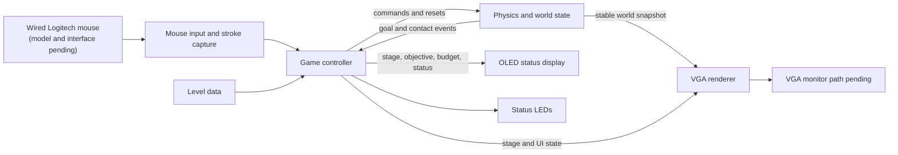

# Q Remastered on FPGA — System Architecture

> Historical preparatory draft. The current implementation contract is [ARCHITECTURE-SPINE.md](ARCHITECTURE-SPINE.md). Decisions and open items below reflect the earlier coaching checkpoint and are superseded by that contract and its `.memlog.md`; do not implement from this historical draft.

## Purpose and status

This is the first architecture draft for the mouse-driven Basys3 puzzle game. It records agreed responsibilities and data flow while leaving hardware-dependent limits open. The exact Logitech mouse model and VGA monitor path are not yet known, so this document does not select their interface hardware or timing.

## Architecture drivers

- Run the demonstrated game in one Basys3 bitstream.
- Include three built-in MVP stages, selectable from the lobby; Stage 3 is the final stage.
- Keep input, game-state ownership, physics state, and rendering responsibilities separate.
- Support one ball and a bounded set of user-drawn, rotating strokes.
- Use the full VGA view for the lobby and playfield; reserve the OLED for stage, objective, strokes remaining, and status.
- Keep all game interaction on the mouse; use LEDs for status.
- Allow five submitted strokes per stage attempt in the MVP: at most six moving rigid bodies, comprising one ball and five strokes, plus up to eight fixed platforms or ramps. The provisional eight-point stroke cap and integrated workload still need resource and timing validation.

## System context

The renderer reads snapshots and does not update the physics world. The game controller owns stage transitions and tells physics when to initialize, pause, resume, or reset a world.

## Component responsibilities

| Component | Owns | Sends or exposes |
|---|---|---|
| Mouse input and stroke capture | Raw mouse interpretation, cursor position, click/drag state, bounded point sampling, and submitted-stroke commands | Cursor/draw preview and stage/menu commands to the game controller |
| Game controller | Lobby, active, paused, and victory states; current stage; stroke allowance; pause/reset/next-stage decisions | World initialization and pause/reset commands; UI state for VGA, OLED, and LEDs |
| Level data | Initial ball pose, fixed obstacles, objective, and per-stage stroke allowance; the left goal boundary is common to all stages | Read-only stage description to game controller and physics |
| Physics and world state | Ball and released-stroke positions, velocities, orientation, angular velocity, collision response, boundaries, and goal overlap | Stable world snapshot, stroke accepted/rejected result, and goal/contact events |
| VGA renderer | VGA timing and drawing of the lobby, playfield, cursor, objects, and menu overlays | Pixel stream to the selected VGA output path; mode and connector remain open |
| OLED and LED outputs | Supporting status presentation | OLED stage/objective/allowance/state and LED pause/victory indications |

## Data and update flow

1. Mouse input samples pointer movement and emits click, drag, release, or menu actions.
2. The game controller validates the action against the current state and stroke allowance.
3. On release, the final sampled stroke is sent to physics as a creation request. Physics validates it against authoritative world state and either inserts one rigid body or rejects the entire request. Only acceptance consumes one stroke; rejection clears the preview, preserves allowance, and produces brief feedback. If pause was requested during drawing, pause follows either result.
4. Physics applies gravity and integrates motion, tests bounded collision candidates, and resolves contacts. During boundary handling, it latches ball contact with the left display edge before left-wall correction and reports the goal event with the world snapshot.
5. The game controller changes to victory when physics reports ball contact with the left goal boundary. It offers Next Stage when available and Back to Lobby; the final stage offers Back to Lobby.
6. VGA rendering consumes a stable world snapshot. The OLED and LEDs consume game-state information from the controller.

## Draft module interface contracts

The following contracts specify logical messages. Numeric formats, physical bus widths, clock crossings, and pin connections remain separate architecture decisions.

| Interface | Payload | Required behavior |
|---|---|---|
| Input to game controller | Cursor position, draw-preview points/count, release request, selected stage/menu action | Preview is presentation state only. During pause, only menu actions are handled; clicks outside menu items have no effect and do not draw. |
| Game controller to physics | Initialize/reset stage, pause/resume, or create-stroke request | Three stage definitions share the left-edge goal rule. Permit at most one outstanding create-stroke request. |
| Create-stroke request | Attempt generation, request identifier, final point count and up to eight sampled points, pending-pause flag | Hold the request stable until received. Physics validates against the authoritative world and commits at most one body for the request. |
| Physics to game controller | Matching attempt/request identifiers, accepted/rejected result, reason, body identifier on acceptance | Debit one stroke exactly once on acceptance. Rejection preserves allowance. A result from an earlier attempt must not alter the current attempt. |
| Physics world snapshot | Attempt generation, snapshot sequence, ball pose/radius, up to five stroke poses/geometries, and goal-contact event | Publish only a complete, stable snapshot. Rendering must not combine states from different snapshots. The goal event is retained until the game controller receives it. |
| Controller to displays | Lobby/active/paused/victory state, stage, objective, allowance, menu selection, transient feedback | VGA reads snapshots and UI state; OLED shows the same accepted allowance. Displays never mutate physics state. |

Reset or loading a stage starts a new attempt generation, cancels any previous pending creation, clears preview/goal state, initializes stage geometry, and restores allowance to five. When a create request carries a pending pause, physics completes admission and freezes the world at the same controlled update boundary, whether accepted or rejected. This prevents another simulation step between admission and pause. The game controller then shows the pause menu.

## Physics representation

- The ball is a circle with translational state.
- Each MVP stage attempt starts with a five-stroke allowance. Submitted strokes remain until the attempt is reset or the player leaves the stage, so the moving-body cap is one ball plus five strokes. Fixed obstacles and display boundaries are counted separately; the left boundary is also the goal.
- A released stroke is one rigid body containing a bounded sampled polyline in local coordinates and a world pose with linear and angular state.
- The starting collision model is one capsule for each adjacent pair of polyline samples. Capsule radius represents the stroke's collision thickness. Use at most eight sample points (seven capsules) per stroke as the provisional first profile; synthesis and timing analysis must validate it.
- Each stage supports up to eight fixed obstacles: thick platforms and sloped ramps, each represented by one static capsule with two world-space endpoints and a radius. Their position and orientation remain fixed; collision response changes only the moving bodies. The MVP obstacle set is limited to these capsules. Level encoding remains open. The four display boundaries are separate from the eight-obstacle cap; the full left boundary is also the goal.
- Use fixed-point arithmetic as the working direction. Coordinate range, fractional precision, rotation representation, mass/inertia approximation, and contact response remain open.
- Narrow-phase work must be bounded. A simple broad-phase bound should reject distant object pairs before capsule contact checks.

The capsule chain is an engineering recommendation, not a measured Basys3 result. It represents continuous stroke thickness; circle samples are cheaper individually but may leave gaps or create an uneven collision surface. A capsule-segment contact test can classify overlap with projection and squared-distance checks, while contact normals and impulses still need a resource-appropriate fixed-point method.

For the provisional workload profile, use `S = 5` simultaneous strokes and `P = 8` sample points per stroke. This is seven capsule segments per stroke, up to 35 ball-to-capsule candidates and 490 stroke-to-stroke capsule-pair candidates per physics update before broad-phase rejection. Across both categories that is at most 525 candidate checks. At 60 updates per second on the Basys3's 100 MHz source clock, the nominal budget is about 1.67 million clock cycles per update; this is a cycle budget, not evidence that a particular synthesized collision/response implementation meets it. Integration, contact resolution, rendering, and clock-domain requirements also consume resources and timing margin.

Without broad-phase rejection, ball-to-stroke checks scale as `S(P - 1)` and stroke-to-stroke segment-pair checks scale as `S(S - 1)(P - 1)^2 / 2`.

| Sample points per stroke (`P`) | Capsule segments per stroke | Ball-to-capsule checks | Stroke-to-stroke capsule-pair checks |
|---:|---:|---:|---:|
| 4 | 3 | 15 | 90 |
| 6 | 5 | 25 | 250 |
| **8 (provisional)** | **7** | **35** | **490** |
| 12 | 11 | 55 | 1,210 |

For `K` fixed capsule obstacles, each obstacle adds one ball-to-capsule candidate and up to 35 stroke-capsule candidates at the selected profile: `K[1 + S(P - 1)] = 36K` additional checks per update. Thus four, eight, and twelve fixed obstacles give totals of 669, 813, and 957 candidates respectively, including the 525 moving-body candidates. These counts exclude display boundary checks (including the left-edge goal check) and repeated solver passes. Fixed obstacles do not need tests against each other. Broad-phase bounds can reduce the counts. These are worst-case candidate counts for one collision-detection pass per physics update, not measured clock or resource estimates.

## Stroke admission

At release, validate the final capsule geometry against the current ball, existing released strokes, and fixed capsule obstacles. Reject positive penetration with any of these objects; tangency is allowed. Ignore contacts between capsules belonging to the same candidate body. Physics owns validation and insertion as one operation against authoritative world state; the game controller decrements allowance only after an accepted result. Rejection creates no body, applies no collision impulse to existing objects, clears the preview, and leaves the count unchanged. The VGA feedback is “Stroke overlaps an object.” Ordinary simulation can continue.

When a pause is pending, resolve the creation request first, then pause after either acceptance or rejection. Validate against the sampled geometry that will actually enter physics, rather than a different raw pointer path. Admission arithmetic and tolerances must be consistent with collision detection.

With seven candidate capsules, up to four existing seven-capsule strokes, eight fixed capsules, and one ball, admission adds up to `7 + 7(4 × 7 + 8) = 259` candidate checks per creation request, excluding boundary handling. At zero allowance no creation request is accepted. Include admission in the workload budget during resource and timing validation.

## Goal boundary

The goal is the entire left display edge in all three stages. With the left edge at `x = 0`, ball center `x_ball`, and radius `r_ball`, contact or overlap satisfies `x_ball - r_ball <= 0` for a ball within the display height. Use signed, sufficiently widened arithmetic so subtraction cannot wrap. Tangency counts. Only the ball can win; stroke contact with the left wall does not.

Latch the winning contact during ball boundary handling before left-wall position correction can discard penetration information, and retain that event through the physics update. The game controller then enters victory and stops the attempt. The left edge remains a containment wall for strokes; the other three display edges are solid, non-goal boundaries. There is no separate per-stage target object.

## Display and clock boundaries

- The VGA screen uses the full view for the lobby or playfield; pause and victory menus are overlays. Exact mode, timing, connector, and frame-consistency strategy depend on the lab display path.
- The Pmod OLED displays stage, objective, stroke count, and status. Exact text layout and refresh ownership remain open.
- Physics advances from a clock-enable or dedicated update schedule; the candidate rate and synchronization to VGA are not finalized.
- Do not allocate a full-resolution frame buffer until its memory and timing cost are checked. Compare procedural rendering and compact buffering against the selected VGA path.

## Open architecture decisions

| Decision | Current state | Needed before |
|---|---|---|
| Mouse connector/protocol and any adapter | Wired Logitech mouse; exact model pending | Input implementation |
| VGA monitor path and mode | Lab connection or adapter unknown | Pin/timing and renderer implementation |
| Fixed-point formats and rotation method | Direction selected; widths and lookup/transform method open | Physics implementation |
| Capsule contact and impulse method, including stroke-to-stroke pairs | Model selected; arithmetic and iteration budget open | Physics implementation |
| Level encoding | Up to eight platforms and ramps use static capsules; storage layout remains open. The full left display boundary is the fixed goal | Level-data implementation |
| Physics/display clock crossing and snapshot consistency | Open | Integrated renderer |
| OLED driver and layout | Role selected; exact device interface and text layout open | Display integration |
| Mouse hit regions | Outside pause-menu items, clicks leave the game paused and menu open; exact hit-region geometry remains open | Input/UI implementation |

## First architecture validation sequence

1. Confirm the Logitech model and VGA lab path when the team has those details.
2. Build a workload estimate for a small number of strokes and capsule segments, then select candidate caps and fixed-point widths.
3. Prototype the physics kernel in a host-side reference model before translating it to RTL, so collision and rotation behavior can be inspected independently.
4. Synthesize bounded workload variants and keep only the feature set that fits the integrated Basys3 design.

## References

- [Box2D collision documentation](https://box2d.org/documentation/md_collision.html) defines circle and capsule primitives and documents collision artifacts possible when connected line segments are treated independently. It is used as a geometry reference, not as a project dependency.
- [Raabe et al., “Hardware-Accelerated Collision Detection using Bounded-Error Fixed-Point Arithmetic”](https://cgvr.cs.uni-bremen.de/papers/wscg06/wscg06.pdf) demonstrates fixed-point FPGA collision-overlap testing for hierarchical DOPs. It supports fixed-point feasibility in general, but does not benchmark this project's 2D capsule chain.
