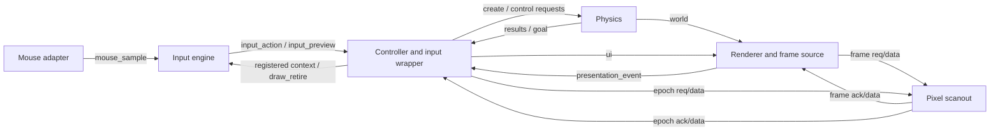

# Controller, input and presentation wiring proposal

Adoption update, 2026-10-17: approved by the user for the initial isolated parallel build, in place of the pending before-coding approvals. Earlier proposal/review-pending wording is the design history. Implementation evidence, completion review and physical/CDC gates remain required.

Prepared 2026-10-17 to address R1 in the [readiness review](../../../docs/reviews/parallel-readiness-review.md). Status: concrete design proposal for owner review; not implemented or signed off. Qi-Ze owns controller/input coordination, Choon Hsiang owns renderer/mailbox transport, and Doyeon reviews admission/world joins.

This refines [module-contracts.md](module-contracts.md) using its revision 2 records. It does not change record packing, enum values or the published headers. New local port names below are proposed explicit connections, not existing `q_ports.vh` macros. Before separate implementations depend on them, the owners must adopt the map and publish any shared port declarations through the normal coordinated contract process.

Reviewable additive declarations are now supplied in [q_parallel_ports_draft.vh](../../../rtl/include/q_parallel_ports_draft.vh), under Q_DRAFT_* names. Existing accepted headers/record packing remain unchanged, and no application source consumes the draft header yet. Adopting these declarations is part of the human start decision.

## Module boundaries

Names below are proposed logical modules, not existing RTL files. Core modules run at 100 MHz with the common synchronous reset. Scanout runs at 25.2 MHz with its domain reset.

The input engine and controller form Qi-Ze's logical wrapper. Their private context/retirement connections do not give input ownership of game mode, allowance or physics results. The renderer's mailbox source captures a return exactly once and separates its bank accounting from the controller notification. The physical top instantiates/connects these blocks; it does not own a duplicate game-state machine.

## Core connection map

All ready/valid channels transfer on a rising edge with valid and ready asserted; sources hold exposed payloads stable until transfer. A core channel is not a CDC mailbox.

| Connection | Producer → consumer | Payload / declaration basis | Storage owner |
| --- | --- | --- | --- |
| `mouse_sample` | Existing mouse adapter → input | Existing `Q_MOUSE_*` roles; `Q_MOUSE_W` | Adapter FIFO; input captures each accepted sample. |
| `input_action` | Input → controller | Existing `Q_INPUT_ACTION_*` roles; `Q_INPUT_ACTION_W` | Input's one held action slot until receipt; controller then owns its accepted command slot. |
| `input_preview` | Input → controller | Existing `Q_INPUT_PREVIEW_*` roles; `Q_PREVIEW_W` | Input's held preview beat; controller retains latest accepted cursor/preview. |
| `create_req` / `ctrl_req` | Controller → physics | Existing independent request roles | Controller owns one request slot per channel and does not couple control readiness to admission arithmetic. |
| `create_rsp` / `ctrl_rsp` / `goal` | Physics → controller | Existing reliable result/goal roles | Physics holds each response; controller matches and accounts for accepted transfers once. |
| `world` | Physics → renderer | Existing `Q_WORLD_*` roles | Renderer retains complete accepted snapshots and freezes the record selected for a render. |
| `ui` | Controller → renderer | Existing `Q_UI_*` roles | Controller owns exposed UI beat and a separate coalescible pending update; renderer retains accepted UI records. |
| `presentation_event` | Renderer/frame source → controller | Proposed `presentation_event_valid`, `presentation_event_ready`, `presentation_event_data[Q_FRAME_ACK_W-1:0]`; reuse the entire existing FrameAcknowledgement record | Renderer owns a one-entry reliable event relay, with capacity reserved before issuing each frame mailbox request. |
| Registered input context | Controller → input, private wrapper connection | Explicit level ports in the next section | Controller owns all context registers; input snapshots gesture identity on press. |
| `draw_retire` | Controller → input, private wrapper ready/valid channel | Explicit fields in the next section | Controller owns a one-entry terminal notification slot; input holds its submitted geometry until matching retirement/cancellation handling. |
| `blocked_draw` | Input → controller, private wrapper ready/valid channel | `blocked_draw_valid`, `blocked_draw_ready`, `blocked_draw_attempt[Q_ID_W-1:0]`, `blocked_draw_view[Q_ID_W-1:0]` | Input retains one feedback-intent event until controller receipt. No create request is generated. |
| `status` | Controller → status logic | Existing `Q_STATUS_*` roles | Status consumer derives LEDs/coherent OLED publication; no writeback to game state. |

No other core consumer directly retires `frame_ack`. Controller and input do not sample the cross-domain acknowledgement bus independently. Only the renderer/frame source owns that mailbox return.

## Controller-to-input context

Use registered core-domain level ports within Qi-Ze's wrapper. They are read-only context, not an action/response channel, and do not need independent bit synchronizers in the same clock domain.

| Proposed port | Width | Meaning |
| --- | --- | --- |
| `ctx_attempt` | `Q_ID_W` | Current authoritative controller attempt. |
| `ctx_view` | `Q_ID_W` | Current authoritative controller view. |
| `ctx_mode` | `Q_MODE_W` | Controller mode used with the matching shared hit-region definition. |
| `ctx_stage` | `Q_STAGE_W` | Current stage key, or NONE. |
| `ctx_presented_valid` | 1 | A PRESENTED event has established that the physical visible attempt/view matches `ctx_attempt`/`ctx_view`; no lifecycle transition has since invalidated eligibility. |
| `ctx_strokes_left` | `Q_ACCEPTED_COUNT_W` | Read-only allowance for zero-allowance feedback intent; input never decrements it. |
| `ctx_create_pending` | 1 | Controller has accepted a draw awaiting a terminal outcome or retirement handoff. |
| `ctx_draw_enabled` | 1 | ACTIVE mode, current visible attempt/view, no pending draw/retirement or higher-priority lifecycle transition, positive allowance and no input-blocking fault. |

Input can track the cursor while drawing is disabled. A fresh left press in the drawable area of the current presented ACTIVE view, at zero allowance and with no outstanding draw, produces one private `blocked_draw` event. Input consumes that gesture without capturing a stroke; release does not send another event or activate pause. Controller rechecks attempt/view/mode/zero allowance and triggers the existing No strokes left feedback. This is separate from permission to start a physical stroke; it does not send an empty/malformed create or require a new public action enum. The event is held stable until receipt, with the same stale-identity drain rule as input actions. Other disabled conditions do not generate misleading allowance feedback.

On press, input latches the current attempt/view and shared control identity only if presentation is eligible. On release, the controller validates that identity again. A mode/layout or attempt change invalidates a gesture even if press and release coordinates coincide. Ordinary physics motion does not invalidate a gesture. Newest-produced UI data is never proof that a view is visible.

Context registers can update together each core edge; input must evaluate eligibility/lifecycle every cycle, independently of whether a mouse/preview/action consumer is stalled. If a context change and an action transfer coincide, the controller applies the existing arbitration rules against its effective transition for that edge and rejects/cancels old identity as appropriate. It never acts on a stale click merely because input observed the prior registered context.

## Pending stroke and retirement

Input keeps a single immutable submitted-stroke slot after release. The reliable `input_action` beat contains that slot's attempt/view and stroke. Cursor and later UI gestures can continue, but a second drawing gesture cannot start until this slot's lifecycle is retired. The action channel becoming ready is receipt, not physics completion.

Controller accepts the draw into its own immutable pending record, allocates the physics request identity, and retains a mapping from that request to the one input submission. It must have reserved command/retirement capacity before accepting the draw; it does not wait for admission arithmetic to finish before capturing a later valid pause command. At most one create is outstanding; an independent control slot remains available.

The wrapper uses these proposed `draw_retire` fields:

| Port | Width / direction | Meaning |
| --- | --- | --- |
| `draw_retire_valid` | 1, controller → input | One terminal lifecycle notification is available. |
| `draw_retire_ready` | 1, input → controller | Input can consume that notification. |
| `draw_retire_attempt` | `Q_ID_W`, controller → input | Attempt of the input submission being retired. |
| `draw_retire_result` | `Q_RESULT_W`, controller → input | Existing OK/REJECTED/CANCELLED/STALE encoding. |
| `draw_retire_reason` | `Q_REASON_W`, controller → input | Existing reason encoding. |

This private notification is not a fabricated physics response. It also covers a draw rejected/cancelled by the controller before physics dispatch. Its identity is sufficient only because the wrapper permits exactly one outstanding input submission, sends exactly one retirement for it, and blocks the next submission until retirement transfers. If that single-slot invariant changes, introduce explicit submission IDs through coordinated contract revision rather than reusing this weaker match rule.

For a real physics response, the controller first matches attempt/request and performs its exactly-once accounting. A successful new acceptance debits once and publishes UI with the response's required-world barrier. Replayed terminal results do not allocate another retirement notification or debit again. Rejection/cancellation does not insert a body or debit allowance. Controller emits one corresponding `draw_retire`; input releases its frozen submission when the matching attempt notification transfers. Unexpected notifications are drained/diagnosed and cannot retire a different live submission.

While retirement is pending, controller retains enough pending geometry to compose the correct preview. Ordinary incoming cursor/preview updates cannot overwrite that frozen proposal or clear it early. After terminal outcome, the controller clears/replaces preview through the world-revision barrier; accepted geometry is rendered from physics rather than painted again as a pending preview.

On new attempt, input may hide/cancel unsent provisional drawing immediately, but cannot overwrite or withdraw an already exposed stalled action. Controller drains the old action by identity and produces its one cancellation retirement if required. Both peers drain an already-held retirement without rewriting it. A terminal result already committed before reset remains immutable; late accounting cannot charge the new attempt. New drawing waits until local outstanding submission/retirement is drained and the new attempt/view has actually been presented.

## Presentation return and bank release

The frame source reserves its one event-relay entry before raising `frame_req`. It holds the entire FramePacket through the existing four-phase CDC handshake. On the first synchronized rising acknowledgement observation for that transaction, it captures FrameAcknowledgement once and performs two local actions:

1. Update renderer ownership accounting using the captured disposition/released_valid/released_bank, while retaining the protocol's full-idle reuse barrier.
2. Store the entire captured record in `presentation_event`, even for dropped/fault dispositions. That relay remains valid/stable until the controller receives it.

The source may lower `frame_req` after capture; it does not require controller event consumption to complete the CDC handshake. Thus a controller waiting for presentation cannot deadlock the pixel mailbox. A new frame request cannot begin until the prior mailbox is fully idle **and** the relay has room. If the controller stalls, scanout repeats its last complete image. Renderer cannot overwrite a completed pending bank or reclaim any bank early to bypass the stall.

Controller consumes the relay independently of create/control arithmetic. Only a current eligible `Q_FRAME_PRESENTED` record updates the retained visible identity or starts the matching feedback timer. Dropped/fault events are acknowledged without pretending that a new screen appeared. Old-attempt events are drained but cannot re-enable drawing, change the new attempt's feedback state or alter allowance. Ordinary frames with unchanged view may still update the presented UI/feedback identity.

The relay is a core ready/valid channel; bank ownership release is still governed by the frame mailbox and scanout pipeline, not by controller `presentation_event_ready`.

## Epoch and status wiring

Controller/integration owns the epoch source registers and pending desired attempt. Choon Hsiang supplies the reviewed source transport and scanout sink behavior; Qi-Ze drives only the desired-epoch interface to that source wrapper. There is one source FSM, not one per developer. Epoch request/acknowledgement is independent of the frame event relay and of admission arithmetic.

On load/reset/discard, invalidate input presentation eligibility immediately, publish the desired epoch without mutating a live mailbox, and complete the physics control transaction using its independent request/result slot. Scanout applies epoch at a safe boundary with priority over frame swap and drains stale frames. Core may send a new attempt's frame only after its epoch acknowledgement is received and the entire epoch handshake is idle; its world/UI join must also satisfy the completed control's required-world barrier. Rendering into a safely owned bank can occur earlier, but publication waits.

Normal LEDs derive from controller status: bit 0 Paused, bit 1 Victory. OLED receives a coherent status record through its own mailbox. Neither display completion nor status consumption grants permission to mutate controller/physics state.

## Startup and proposed acceptance traces

Startup initializes core slots invalid, presentation eligibility false, retirement/event relays empty and mailbox req/ack idle. Pixel front bank 0 is invalid; renderer owns bank 1; output remains black until an eligible complete frame is presented. Gameplay stage reset is an ordinary transaction, not a unilateral transport/peripheral reset.

| Trace | Required result |
| --- | --- |
| Frame ack arrives while controller event-ready is low | Bank accounting captures once, event is retained, four-phase mailbox can drain, and a later frame waits for relay capacity. |
| Frame is dropped on epoch change | Relay reports the drop; old front-bank ownership is not falsely released and input is not told the new view appeared. |
| Newest UI differs from actual screen | Input eligibility remains false for unmatched mode/attempt/view; no guessed presentation from UI publication. |
| Admission accepts and its result is replayed | One allowance debit and one input retirement; UI joins a world at/after the acceptance barrier without duplicate preview. |
| New-attempt reset arrives while old draw action is stalled | Preserve exposed action, drain it as old traffic, retire the old submission once and prevent charges/clicks in the new attempt. |
| Fresh pause click while create arithmetic is busy | Controller receives it through an available action/control path; pending draw blocks a second draw but does not disable all UI actions. |
| Terminal response, input retirement and context change coincide | Existing arbitration governs effective state; no new draw starts from old eligible context, and immutable terminal records are drained once. |
| Controller requests another epoch while old frame event is stalled | Epoch transport continues independently; delayed old event cannot restore eligibility for an obsolete attempt. |

These are planned traces, not executed tests. The four existing Story 1 CDC findings remain open; this proposal does not justify or suppress them. Named owner review is pending, and R1 is considered specified for review rather than accepted for implementation.
